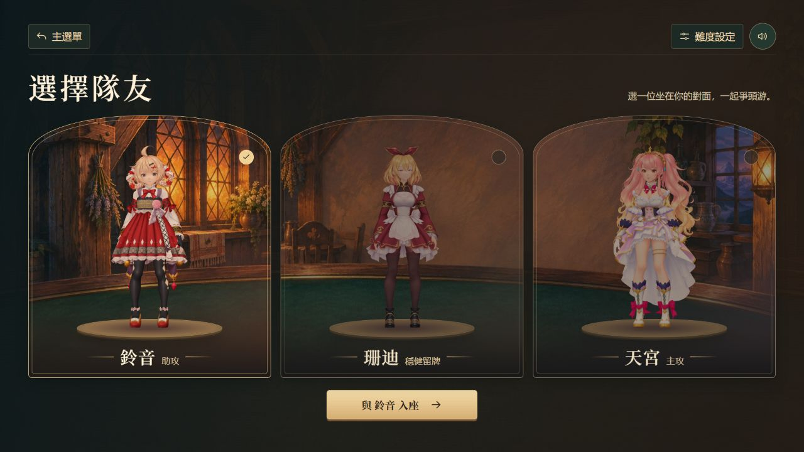
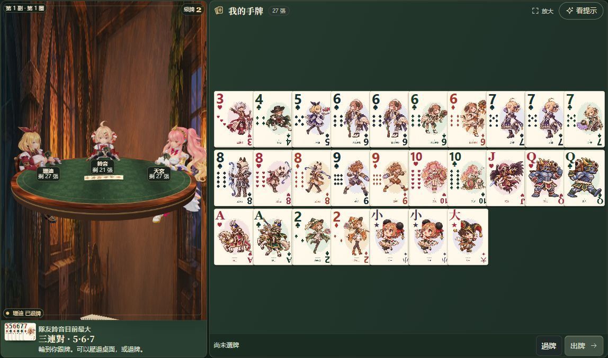

# Truce Day at the Crystal Pavilion · 2v2 Guandan

[繁體中文](README.md) · English · [日本語](README.ja.md)

Choose Suzune, Sandy, or Amamiya as the partner across the table. Work together to play out your cards before the other team.

[**Play in your browser**](https://letztek.github.io/guandan-web/?lang=en) · [Install locally](#install-and-play-locally)



## Basic rules

- Four players form two teams, with partners seated across from each other. Each player gets 27 cards from two decks.
- Lead a single, pair, full house, straight, or another valid combination. To follow, play a stronger combination of the same type, use a bomb against an ordinary combination, or pass.
- When everyone else passes, the last person who played leads again. If that player has already gone out, their partner leads instead.
- Both teams start at level 2. The team that goes out first advances three levels if the partner finishes second, two for third, and one for fourth. When your team is playing at level A, take first place and have your partner finish second or third to win the match.



## Install and play locally

1. Install Node.js 22.13 or later in the 22.x series. [Download Node.js](https://nodejs.org/en/download)
2. Download and extract the ZIP. Open a terminal in the folder containing `package.json`. [Download the game ZIP](https://github.com/letztek/guandan-web/archive/refs/heads/main.zip)
3. Run these two commands.

   ```sh
   npm ci
   npm run dev
   ```

4. Open the local address printed in the terminal in your browser. [Default address](http://127.0.0.1:5173/)

## Use and credits

The project author permits downloading, installing, and playing the game on your own device. Please obtain permission from the appropriate rights holders before redistributing, adapting, or otherwise reusing it.

The character models and facial animation were made using Nano’s toolkit. [Charakuru](https://github.com/nanocle/Charakuru)
