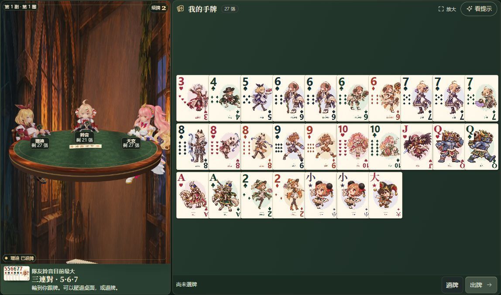

# 水晶亭の休戦日 · 2対2の摜蛋（グアンダン）

[繁體中文](README.md) · [English](README.en.md) · 日本語

鈴音、サンディ、天宮から相棒を選んで、カード卓へ。向かいに座る相棒と協力し、相手チームより先に手札を出し切りましょう。

[**ブラウザで遊ぶ**](https://letztek.github.io/guandan-web/?lang=ja) · [パソコンにインストール](#パソコンにインストールして遊ぶ)


## 基本ルール

- 4 人で遊び、向かいに座る 2 人がチームになります。トランプ 2 組を使い、1 人に 27 枚ずつ配ります。
- 1 枚、ペア、フルハウス、ストレートなどの役で始められます。続けるときは同じ役でより強いカードを出すか、パスします。通常の役には爆弾役で対抗できます。
- 他の全員がパスすると、最後にカードを出した人が次の手を始めます。その人がすでに上がっていれば、相棒が代わりに始めます。
- 両チームともレベル 2 から始めます。1 位になった人の相棒が 2 位なら 3 段階、3 位なら 2 段階、4 位なら 1 段階上がります。自チームのレベル A が採用された回で、1 人が 1 位、相棒が 2 位または 3 位なら勝利です。



## パソコンにインストールして遊ぶ

1. Node.js 22.13 以降の 22.x をインストールします。[Node.js をダウンロード](https://nodejs.org/en/download)
2. ZIP ファイルをダウンロードして展開し、`package.json` があるフォルダーでターミナルを開きます。[ゲームの ZIP をダウンロード](https://github.com/letztek/guandan-web/archive/refs/heads/main.zip)
3. 次の 2 行を順に実行します。

   ```sh
   npm ci
   npm run dev
   ```

4. ターミナルに表示されたローカルアドレスをブラウザで開きます。[初期アドレス](http://127.0.0.1:5173/)

## 利用とクレジット

プロジェクト作者は、ご自身の端末へのダウンロード、インストールおよびプレイを許可しています。再配布、改変、その他の利用については、事前に該当する権利者の許可を得てください。

キャラクターの 3D モデルと表情の動きの制作に、Nano 氏のツールを使用しています。[Charakuru（きゃらくる）](https://github.com/nanocle/Charakuru)
