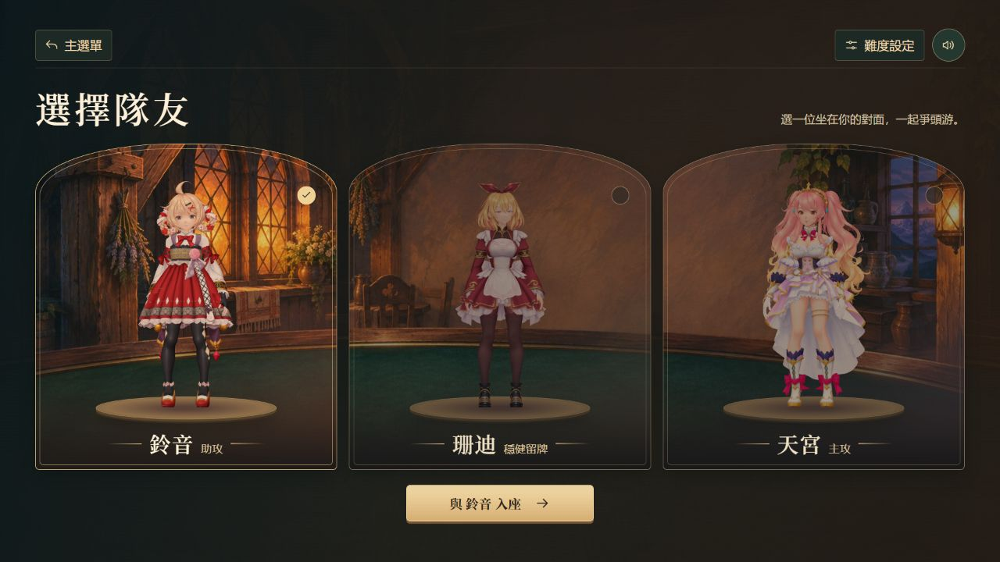
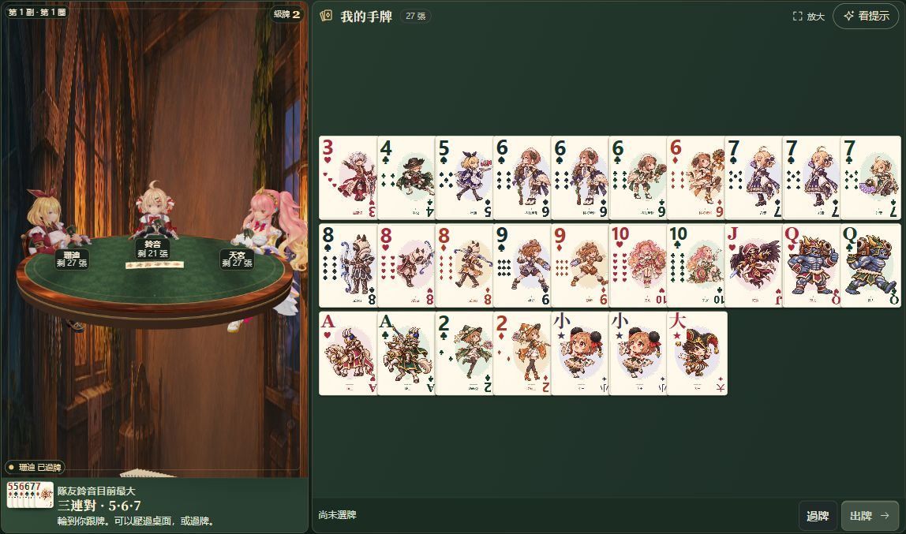

# 水晶亭的休戰日 · 二對二摜蛋

繁體中文 · [English](README.en.md) · [日本語](README.ja.md)

在水晶亭選擇鈴音、珊迪或天宮當隊友，與對家的她一起打摜蛋，爭取先出完手牌。

[**立即遊玩**](https://letztek.github.io/guandan-web/?lang=zh-Hant) · [在電腦上安裝](#在電腦上安裝與遊玩)



## 基本規則

- 四人對坐組隊，使用兩副撲克牌，每人 27 張。
- 可以領出單張、對子、三帶對或順子等牌型。跟牌要用更大的同牌型，可以過牌，也可以用炸彈壓一般牌型。
- 其他玩家都過牌後，由最後出牌者重新領出。若他已出完，就由對家的隊友接風。
- 雙方從 2 級開始。拿頭游的一方依隊友名次升級，二游升 3 級、三游升 2 級、末游升 1 級。己方主打 A 時，拿下頭游並讓隊友拿到二游或三游，就贏得整場。



## 在電腦上安裝與遊玩

1. 安裝 Node.js，建議使用 22.13 或更新的 22.x 版本。[下載 Node.js](https://nodejs.org/en/download)
2. 下載並解壓縮，在含有 `package.json` 的資料夾開啟終端機。[下載遊戲 ZIP](https://github.com/letztek/guandan-web/archive/refs/heads/main.zip)
3. 依序執行下面兩行指令。

   ```sh
   npm ci
   npm run dev
   ```

4. 用瀏覽器開啟終端機顯示的本機網址即可遊玩。[預設網址](http://127.0.0.1:5173/)

## 使用與致謝

專案作者授權下載、在自己的裝置上安裝和遊玩。重新散布、改作或其他用途，請先取得相應權利人的同意。

角色的 3D 模型和表情動作製作使用了 Nano 的工具。[Charakuru](https://github.com/nanocle/Charakuru)
